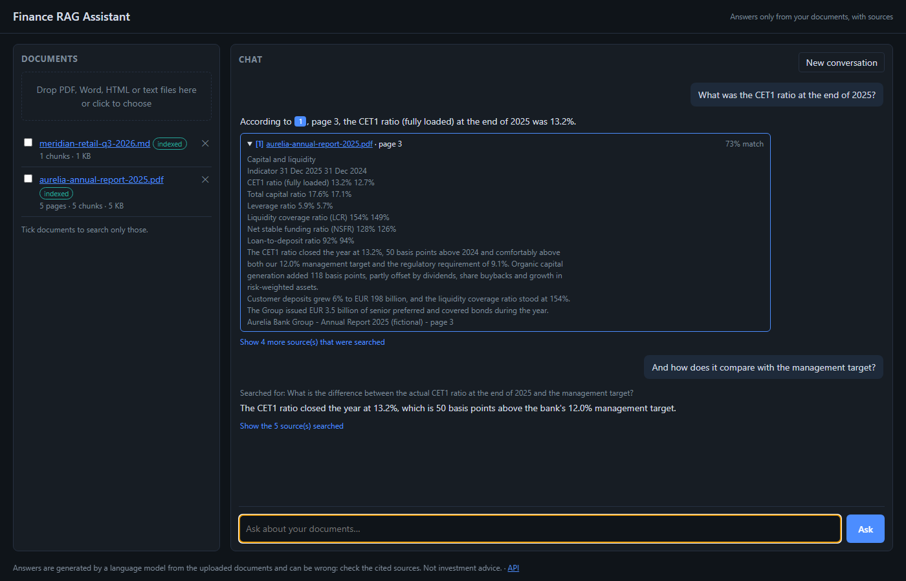
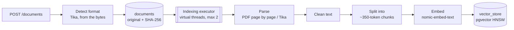
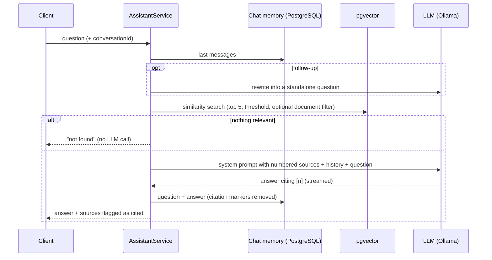

# Finance RAG Assistant

[](https://github.com/Adri23Ausin/finance-rag-assistant/actions/workflows/ci.yml)


Ask questions about financial reports in plain language and get answers **with citations to the exact file and page**. Built with **Spring AI**: documents are parsed, chunked and embedded into **PostgreSQL with pgvector**, and a **local LLM through Ollama** answers from the most relevant passages only. No API keys, no data leaving your machine.



*Real answers from `llama3.2` on the fictional sample report. The follow-up was rewritten into a standalone question before searching.*

### Author: Adrián Ausín Cuesta

## Contents

1. [Features](#features)
2. [Tech stack](#tech-stack)
3. [How it works](#how-it-works)
4. [Run it](#run-it)
5. [API](#api)
6. [Tests](#tests)
7. [Design decisions](#design-decisions)
8. [Possible improvements](#possible-improvements)

## Features

- **Upload PDF, Word, HTML, Markdown or text.** The format is detected from the content, not trusted from the client. PDFs are read page by page so every answer can point to its page.
- **Background indexing** on virtual threads with bounded concurrency, with status per document (`INDEXING`, `INDEXED`, `FAILED` with the reason), duplicate detection by SHA-256, re-indexing and recovery after a restart.
- **Grounded answers with numbered citations.** The model only sees the retrieved passages, must cite them as `[n]`, and the response lists every source with file, page, excerpt and similarity score. Questions with nothing relevant are answered "not found" without calling the model.
- **Conversations** stored in PostgreSQL. Follow-ups like "and the dividend?" are rewritten into standalone questions before searching.
- **Streaming** answers token by token over Server-Sent Events.
- **Search scope**: limit a question to some documents.
- **Web UI** at `/`: drag-and-drop upload, live indexing status, streaming chat, citation chips that open the source and link to the PDF page.
- **Runs offline for development** (`./mvnw spring-boot:test-run`) with stand-in models, and every test runs without a model server.

## Tech stack

| Area | Technology |
|---|---|
| Language | Java 21 (records, sealed interfaces, pattern matching for `switch`, virtual threads) |
| Framework | Spring Boot 4.1, Spring MVC, Spring AI 2.0 (`ChatClient`, `VectorStore`, chat memory, query transformers) |
| Models | Ollama: `llama3.2` for chat, `nomic-embed-text` for embeddings (both configurable) |
| Documents | Spring AI PDF reader (Apache PDFBox), Apache Tika, token-based splitter |
| Data | PostgreSQL 17 + pgvector (HNSW index, cosine distance), Flyway, `JdbcClient` |
| API docs | springdoc-openapi 3 |
| Tests | JUnit 5, AssertJ, `MockMvcTester`, Awaitility, Testcontainers (pgvector) with deterministic fake models |
| Build & delivery | Maven wrapper, multi-stage Docker image, Docker Compose, GitHub Actions |

## How it works

### Indexing



Each chunk is stored with `document_id`, `filename`, `page` and `chunk` metadata. A chunk never spans two pages, so its citation is always exact.

### Answering a question



```
src/main/java/com/adrianausin/financerag
├── ingestion/   # Format detection, PDF and Tika parsers, cleaning and chunking
├── document/    # Stored documents, background indexer, service
├── chat/        # Retrieval, prompt, citations, conversation memory, streaming
└── api/         # REST and SSE endpoints, problem details
```

## Run it

Requires **Docker**. To run outside Docker you also need **JDK 21**.

### Everything in Docker

```bash
docker compose --profile app up --build
```

Open http://localhost:8080 and upload the sample documents in [`samples/`](samples): a fictional bank annual report (PDF) and a fictional retail quarterly release (Markdown).

On the first start the application pulls `llama3.2` (about 2 GB) and `nomic-embed-text` into a Docker volume, which takes a few minutes; later starts are immediate. By default the models run on CPU: on a 16-core laptop without GPU an answer took about a minute (follow-ups a little longer, because of the rewrite), while off-topic questions return at once. With an NVIDIA GPU, give the `ollama` service access to it in Compose. Other models can be set with `CHAT_MODEL` (an embedding model with a different dimension needs a new migration). Host ports are configurable with `APP_PORT`, `POSTGRES_PORT` and `OLLAMA_PORT`.

### On your machine

```bash
docker compose up -d                  # PostgreSQL with pgvector and Ollama
./mvnw spring-boot:run                # macOS / Linux
.\mvnw.cmd spring-boot:run            # Windows
```

### Without Ollama (UI and API work)

```bash
./mvnw spring-boot:test-run
```

Starts PostgreSQL in a container and replaces the models with stand-ins: a hashing embedding model and a chat model that simply quotes the best passage. Retrieval, citations, streaming and the UI all work; the "answers" are not real.

## API

[`requests.http`](requests.http) has ready-to-run examples. Swagger UI: http://localhost:8080/swagger-ui.html

| Method | Path | Description |
|---|---|---|
| `POST` | `/api/v1/documents` | Upload a file (multipart `file`). `202` while indexing; `200` with the existing document if it was uploaded before |
| `GET` | `/api/v1/documents` | Documents with status, pages and chunks |
| `GET` | `/api/v1/documents/{id}` | One document |
| `GET` | `/api/v1/documents/{id}/file` | The original file (PDFs open at a page with `#page=N`) |
| `POST` | `/api/v1/documents/{id}/reindex` | Index again |
| `DELETE` | `/api/v1/documents/{id}` | Delete the document and its chunks |
| `POST` | `/api/v1/chat` | Ask `{"question": "...", "conversationId": "...", "documentIds": [...]}` (last two optional) |
| `POST` | `/api/v1/chat/stream` | Same, as SSE: `sources`, `token`…, `done` (or `error`) |
| `GET` | `/api/v1/conversations/{id}/messages` | Conversation history |
| `DELETE` | `/api/v1/conversations/{id}` | Forget a conversation |

A real `POST /api/v1/chat` response (shortened):

```json
{
  "conversationId": "5d0b6c1e-6a4f-4f0e-9a43-2a4b8f1d7c3e",
  "text": "According to [1], page 3, the CET1 ratio (fully loaded) at the end of 2025 was 13.2%.",
  "searchQuery": "What was the CET1 ratio at the end of 2025?",
  "sources": [
    { "number": 1, "filename": "aurelia-annual-report-2025.pdf", "page": 3, "score": 0.731, "cited": true,
      "excerpt": "Capital and liquidity\nIndicator 31 Dec 2025 31 Dec 2024\nCET1 ratio (fully loaded) 13.2% 12.7% ..." },
    { "number": 2, "filename": "aurelia-annual-report-2025.pdf", "page": 2, "score": 0.597, "cited": false,
      "excerpt": "Financial highlights\nIndicator 2025 2024 Change\nNet interest income (EUR m) 4,130 3,824 +8.0% ..." }
  ]
}
```

Errors are [RFC 9457](https://www.rfc-editor.org/rfc/rfc9457) problem details: `415` for unsupported formats, `400` for empty files or invalid questions, `404` for unknown documents and `503` when the model server is down or lacks the model.

## Tests

```bash
./mvnw verify    # needs Docker running for Testcontainers
```

No model server is needed. The tests use pgvector in a container and two fake models:

- a **hashing embedding model** (bag of words hashed into 768 dimensions), so similarity search in pgvector returns meaningful results: a question about the CET1 ratio really finds the capital page;
- a **scripted chat model** that returns the replies queued by each test and records every prompt, so tests check exactly what the LLM receives.

| Kind | What they cover |
|---|---|
| Parsing & chunking | Page numbers, blank pages, HTML/Markdown/text via Tika, format detection from content, token budget, chunks never crossing pages, text cleaning |
| Indexing (Testcontainers) | Background indexing and status, page metadata in pgvector, duplicates, unsupported and empty files, documents without text, deletion, re-indexing, recovery after restart, download |
| Answers | Numbered sources in the system prompt, cited sources flagged, invented citations ignored, "not found" without calling the model, search limited to some documents, validation |
| Conversations | Follow-ups rewritten with the history before searching, history sent without citation markers, read and forget, conversations kept apart |
| Streaming | Event order, tokens keep their spaces, citations at the end, answer remembered when complete, error event mid-stream |
| Failures | `503` with the reason when the model is unavailable, also for streamed questions |

## Design decisions

- **Citations are part of the contract.** Sources are numbered in the prompt and the model must cite `[n]`; the server parses the citations and returns them with file, page and excerpt, so a user can check every figure. Citations to sources that don't exist are dropped.
- **No relevant passage, no model call.** If nothing passes the similarity threshold the answer is "not found" right away. Asking the model anyway mostly produces confident made-up numbers, which is the worst failure for a finance tool.
- **Documents are data, not instructions.** Sources go inside a delimited block of the system prompt, which tells the model to ignore instructions found in them. It is a mitigation against prompt injection from uploaded files, not a guarantee.
- **Page-aware chunking.** PDFs are split page by page and chunks never cross a page, trading slightly less context per chunk for exact citations. Layout padding and control characters are cleaned first (PostgreSQL rejects `NUL`, which PDFs sometimes contain).
- **Follow-ups are rewritten before retrieval.** "And the dividend?" retrieves nothing useful on its own. One extra model call turns it into a standalone question; the response shows what was searched for. It can be turned off with `rag.retrieval.rewrite-follow-ups`.
- **Memory without citation markers.** `[1]` in an earlier answer refers to that turn's sources; keeping it would make the model cite the wrong source in the next turn.
- **Originals are kept.** Storing the file next to its metadata makes the index rebuildable: changing the chunk size or the embedding model is a re-index, not a re-upload. The SHA-256 avoids storing the same file twice, including concurrent uploads.
- **Bounded background indexing.** Embedding is limited by the model server, so documents are indexed on virtual threads but at most two at a time. Indexing is idempotent (it replaces a document's chunks), which makes retries and restart recovery simple.
- **Schema owned by Flyway.** The vector table (with an HNSW index and a GIN index on metadata) and the chat memory table are migrations, not created by Spring AI at startup, so the embedding dimension is an explicit, versioned decision.
- **Local models by default.** Financial documents are often confidential; Ollama keeps everything on the machine. Spring AI's abstractions mean switching to a hosted model is a dependency and configuration change. Two details that matter with Ollama: its default context window (2048 tokens) would silently cut off the sources, so it is raised to 8192, and Tomcat's 30-second async timeout is raised for slow CPU generation.
- **Small models need checking.** With `llama3.2` (3B) the answers to the sample questions were correct, and a question the documents don't answer ("the share price target") got "could not find" instead of an invented figure. But one follow-up was answered correctly without its `[n]` citation; the UI then still offers the sources that were searched. Larger models are worth trying when a GPU is available.
- **Tests that don't need an LLM.** Deterministic fakes make the tests fast and reliable and let them assert the exact prompt. What they cannot test is answer quality; that needs an evaluation set (see below).

## Possible improvements

- An evaluation suite with questions and expected answers per sample document, scored with Spring AI evaluators.
- Hybrid search (PostgreSQL full-text + vectors) and re-ranking, which helps with exact terms like ticker symbols or "CET1".
- Table-aware extraction for financial statements, and OCR for scanned PDFs.
- Users and per-user document collections.
- Token usage and latency metrics from Spring AI's Micrometer observations.

## License

[MIT](LICENSE)
